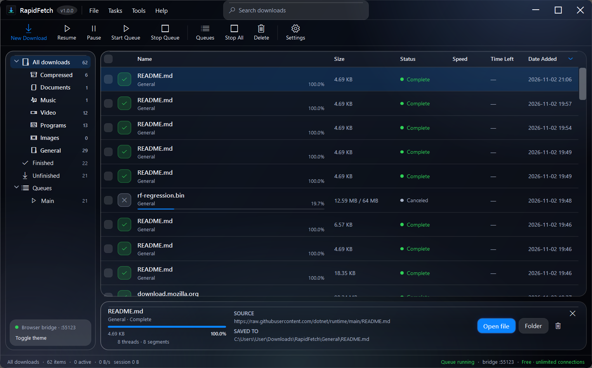
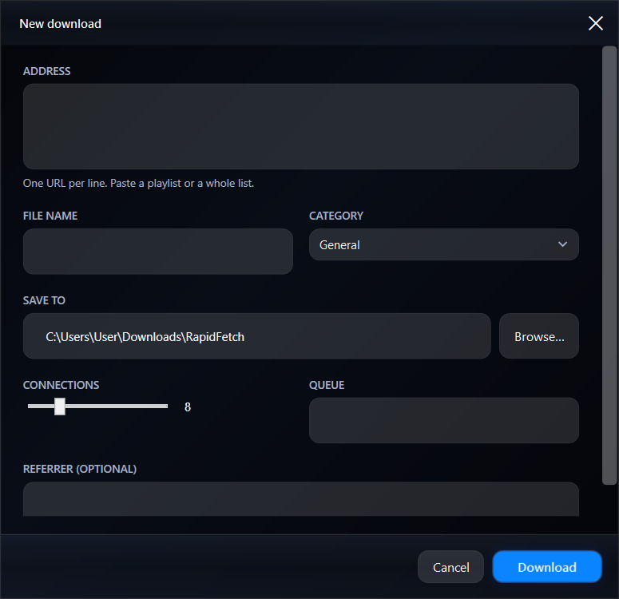
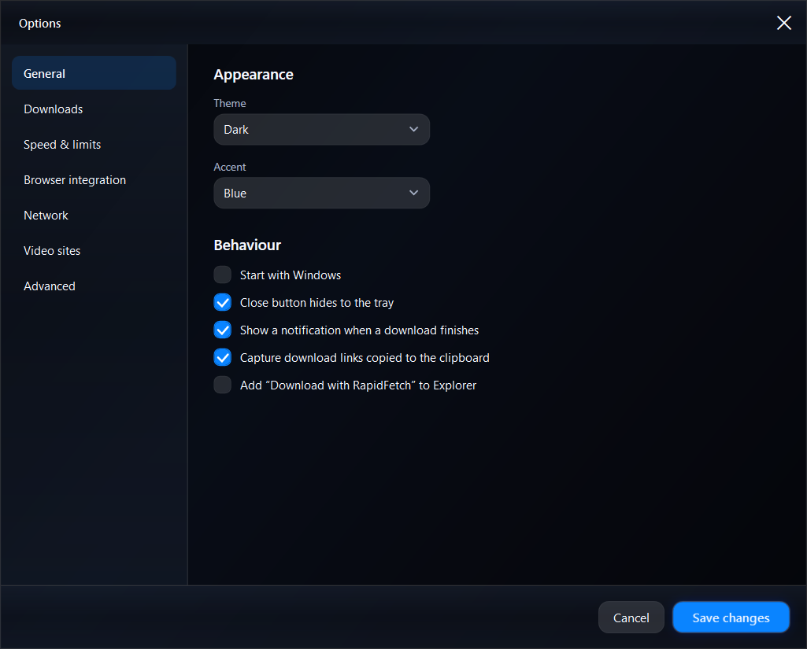
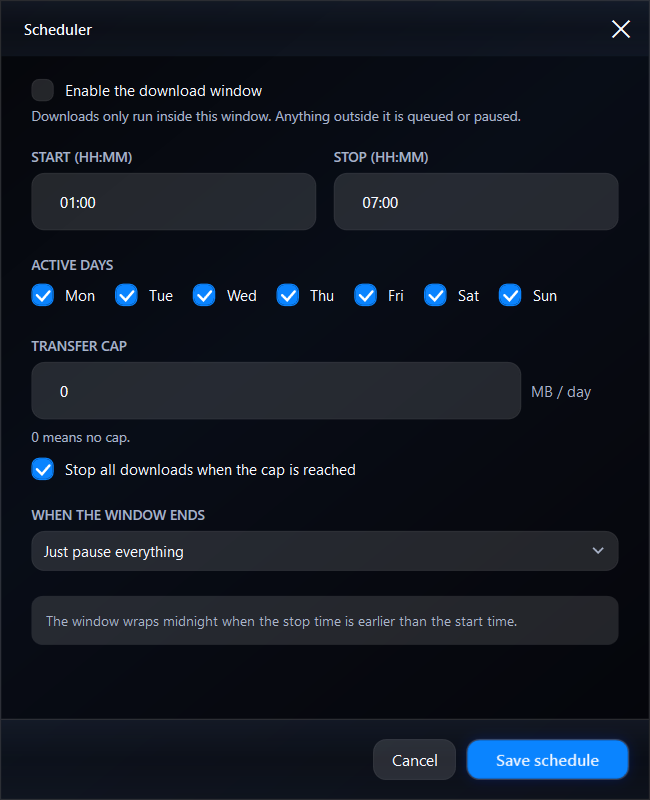
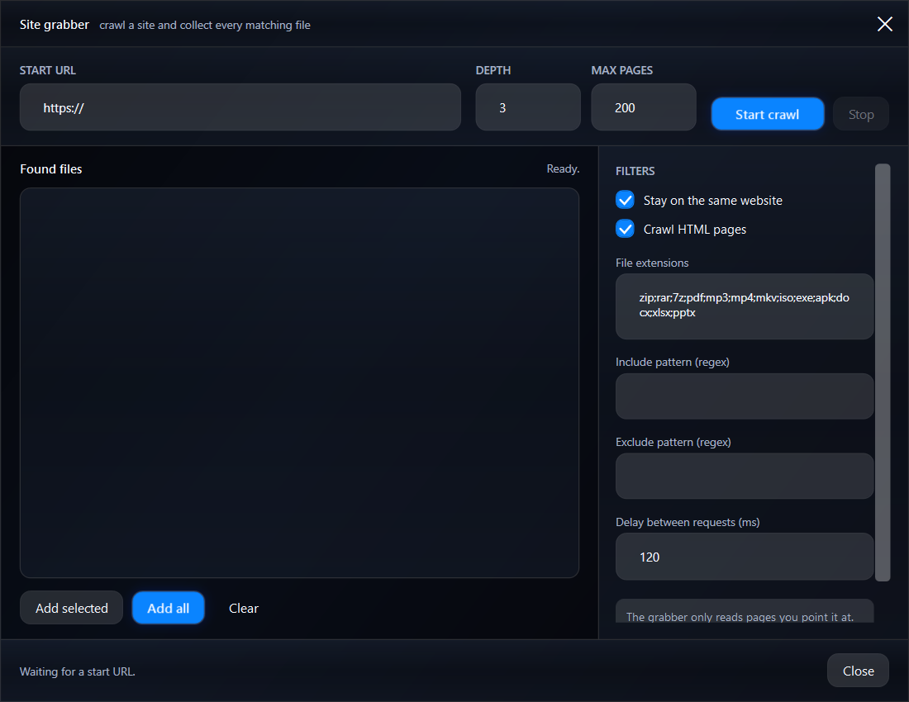
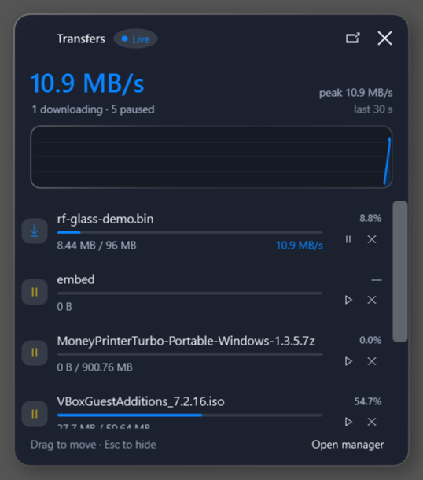
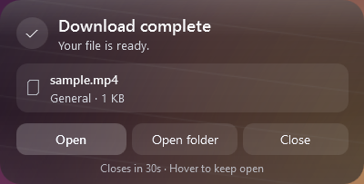

# RapidFetch

[](https://github.com/sohanur999999/rapidfetch/releases/latest)
[](#chrome-extension-manual-install)
[](LICENSE)
[](#install)

RapidFetch is a **free download manager for Windows** with a native **Chrome
extension**. It accelerates files with segmented, resumable transfers, captures
video and HLS media from the browser, queues batch downloads, and schedules them
— **free for life**, with no trial, subscription, account or activation server.

It was built as a clean-room, feature-complete alternative to Internet Download
Manager: segmented transfers, resume, scheduler, browser capture, media
detection, site grabbing, speed limits, categories, tray integration and a native
MV3 browser extension. There is no trial clock, registration key, activation
server or admin install.



## Get RapidFetch

| Download | Link |
| --- | --- |
| Chrome extension | [Manual ZIP install](#chrome-extension-manual-install) |
| Chrome extension ZIP | [RapidFetch-Extension-1.0.0.zip](https://github.com/sohanur999999/rapidfetch/releases/latest/download/RapidFetch-Extension-1.0.0.zip) |
| Windows installer | [RapidFetch Setup 1.0.0](https://github.com/sohanur999999/rapidfetch/releases/latest/download/RapidFetch-Setup-1.0.0.exe) |
| Portable EXE | [RapidFetch 1.0.0 standalone](https://github.com/sohanur999999/rapidfetch/releases/latest/download/RapidFetch-1.0.0-standalone-win-x64.exe) |
| Folder package | [RapidFetch 1.0.0 zip](https://github.com/sohanur999999/rapidfetch/releases/latest/download/RapidFetch-1.0.0-win-x64.zip) |
| Extension ZIP (unpacked) | [RapidFetch-Extension-1.0.0.zip](https://github.com/sohanur999999/rapidfetch/releases/latest/download/RapidFetch-Extension-1.0.0.zip) |
| Landing page | [sohanur999999.github.io/rapidfetch](https://sohanur999999.github.io/rapidfetch/) |
| Privacy policy | [PRIVACY.md](PRIVACY.md) |

## Free for life

RapidFetch is free for life. Every core feature in this README is included in the
free build: segmented downloads, resume, scheduler, Chrome capture, media
detection, queues, speed limits, categories, backup/restore and the optional
yt-dlp integration. There is no paid tier, no locked "Pro" feature, no trial
clock, no subscription, no account and no activation server.

If that ever changes, this README and the public download page will say so before
anything is paywalled. The **Free for life** claim applies only while all current
core features remain free.

## Highlights

- **Segmented engine** - up to 32 HTTP range connections per file, live speed and
  ETA, per-segment retry, automatic resume from a `.part` file, and safe
  finalization. Servers without range support fall back to a single stream.
- **Queue and scheduler** - max concurrent downloads, transfer cap per day,
  time window with midnight wrap, active weekdays, and optional exit, sleep,
  hibernate or shutdown when the queue finishes.
- **Browser integration** - MV3 extension for Chrome, Edge, Brave, Chromium,
  Vivaldi and Opera. Fixed extension ID, native messaging host, and a localhost
  HTTP bridge fallback. Captures downloads, links, media and context-menu clicks.
- **IDM-style media panel** - a floating blue **Download this video** button on
  pages with media, plus a popup with labeled Download buttons, file sizes,
  Download all, live queue progress and pause/resume/remove controls.
- **Video sites with yt-dlp** - optional integration for YouTube, Facebook and similar
  pages whose audio and video arrive as separate tracks. RapidFetch selects the
  configured quality (best, 1080p, 720p, 480p or audio only), supports playlists
  and browser cookies, and merges the result with ffmpeg. yt-dlp is installed
  from the app with one click or you can point at an existing copy.
- **Floating transfer panel** - when a download starts while the manager is
  minimised or in the background, a small always-on-top panel shows the live
  speed graph and each transfer. Pause, resume and cancel from the panel. When
  the queue finishes, a compact borderless glass completion popup offers
  **Open**, **Open folder** and **Close** for the newest file.
- **History-safe browser capture** - reopening the browser does not replay old
  download history into the queue. Captures carry their Chrome start time, recent
  captures are remembered, and the app ignores capture requests for files it has
  already finished.
- **Media grabber** - detects direct media and HLS playlists in the page and in
  network requests; downloads and joins HLS segments (`playlist.m3u8` -> `.ts`).
  DASH manifests, fragmented `.m4s` tracks and YouTube googlevideo streams are
  filtered from the built-in grabber because separate audio/video tracks are not
  muxed by the native engine; the optional yt-dlp path handles those pages.
- **Site grabber** - same-site crawl with depth/page limits, extension filters,
  regex include/exclude rules, request delay, and one-click batch add.
- **Network controls** - optional HTTP, HTTPS, SOCKS4 or SOCKS5 proxy with
  authentication, live per-download speed limit, per-item connection count and
  referrer support.
- **Repair and portability** - refresh an expired or signed download address,
  export the download list as CSV, import a list of links, and back up or restore
  all settings.
- **Everything a downloader needs** - multi-URL add dialog, clipboard capture,
  categories and custom folders, search and filters, sortable columns, a details
  panel under the list, notifications, tray, light/dark/system themes, six accent
  colors, and Explorer shell integration that is off by default inside the app.
- **Liquid-glass look** - the default dark theme uses low-saturation smoked glass,
  a quiet aurora backdrop, specular rims and an iOS blue accent. The same material
  is used on the manager, options, add dialog, scheduler, site grabber and transfer
  panel; light and system themes remain available. The completion popup is a
  compact, borderless version of the same neutral glass in every theme, with the
  page showing through instead of an opaque backdrop.
- **AB-style manager** - a File / Tasks / Tools / Help menu bar with centered
  search, a labeled action toolbar, a category and queue tree, checkbox row
  selection, column-header sorting and a bottom details panel that opens only
  when a row is selected.
- **One-click setup** - a single self-contained setup executable with a real GUI,
  per-user install, silent mode, shortcuts, uninstall entry and browser host
  registration. No administrator, runtime or companion files needed.
- **Unlocked** - every feature is available in the free build. No "buy now",
  no fake trial, no patched binaries, no background licensing service.

## Screenshots

| Add download | Options |
| --- | --- |
|  |  |

| Scheduler | Site grabber |
| --- | --- |
|  |  |

| Floating transfers | Download complete |
| --- | --- |
|  |  |

Store-ready 1280x800 screenshots, the 440x280 promo tile, the 1400x560 marquee
and the GitHub social preview live in [`docs/store-assets`](docs/store-assets).

## Install

Requirements: Windows 10 or 11, 64-bit. All builds are self-contained, so the
.NET runtime is **not** required. Installation is per-user; no administrator
rights are needed.

### Chrome extension (manual install)

The Chrome Web Store listing is not live yet. Until it is, load the official
extension package once in Chrome. Install the Windows app first (see
[Setup app](#setup-app-recommended)) so the native messaging host is registered.

1. Download
   [RapidFetch-Extension-1.0.0.zip](https://github.com/sohanur999999/rapidfetch/releases/latest/download/RapidFetch-Extension-1.0.0.zip).
2. Extract the ZIP to a permanent folder. Do not select the ZIP itself. The
   folder you select must contain `manifest.json` at its top level.
3. Open `chrome://extensions` in Chrome, turn on **Developer mode**, click
   **Load unpacked**, and select the extracted folder.
4. Pin RapidFetch to the toolbar. The extension uses the stable ID
   `lmbdeehijjekhepgoioomfgobpkgmlcb` and connects to the desktop app through the
   native messaging host.

If you used the setup app, you can skip the ZIP and load
`%LOCALAPPDATA%\Programs\RapidFetch\extension` instead. That folder contains the
same extension.

Chrome shows a developer-mode reminder while an unpacked extension is loaded.
That is expected for manual installs. Once the Chrome Web Store listing is
available, this README will link to it. The extension itself is free today.

> Chrome-branded builds ignore `--load-extension` on the command line. Use the
> **Load unpacked** button, not a command-line flag.

### Setup app (recommended)

Run `dist\RapidFetch-Setup-<version>.exe`. The setup window installs to
`%LOCALAPPDATA%\Programs\RapidFetch` by default and lets you choose a folder,
a desktop shortcut, start with Windows and Explorer context menu entries.

Setup copies the app, browser extension, native host identity, docs and
uninstaller, registers the native messaging host for Chrome, Edge, Brave,
Chromium, Vivaldi and Opera, and adds an Apps & Features entry. Browser
integration is always installed; the extension itself is loaded once by the
user.

Silent or scripted installs use the same executable:

```powershell
.\RapidFetch-Setup-<version>.exe --silent --launch
.\RapidFetch-Setup-<version>.exe --silent --install-dir "D:\Apps\RapidFetch" `
  --no-desktop --no-shell --no-startup --no-launch
```

The setup binary is the same self-contained single-file build as the app. A
copy named `RapidFetch.exe` runs normally; `setup` in the file name (or
`--setup`) selects installer mode.

### Folder package

1. Extract the release zip.
2. Run PowerShell in the extracted `RapidFetch` folder:

   ```powershell
   powershell -ExecutionPolicy Bypass -File .\install.ps1
   ```

   The folder installer copies the app to
   `%LOCALAPPDATA%\Programs\RapidFetch`, registers the native messaging host,
   adds the Explorer context menu and start-with-Windows entry, creates a Start
   Menu shortcut, and launches the app.

   Useful switches:

   ```powershell
   .\install.ps1 -NoShellIntegration      # skip the Explorer context menu
   .\install.ps1 -NoStartWithWindows      # skip the Run key
   .\install.ps1 -DesktopShortcut         # also create a desktop shortcut
   .\install.ps1 -NoLaunch                # install only
   .\install.ps1 -InstallDir "D:\Apps\RapidFetch"
   ```

3. Load the extension once in your browser:
   - **Chrome / Brave / Vivaldi / Opera:** open `chrome://extensions`, enable
     **Developer mode**, click **Load unpacked**, and select
     `%LOCALAPPDATA%\Programs\RapidFetch\extension`.
   - Edge: open `edge://extensions` and use the same **Load unpacked** flow.

   The extension has the stable ID `lmbdeehijjekhepgoioomfgobpkgmlcb`. Pin it to
   the toolbar.

4. Click any download link. RapidFetch intercepts `chrome.downloads`, cancels the
   browser copy and downloads through the app. If RapidFetch is not running, the
   native host starts it automatically. Reopening the browser does not re-add
   downloads that Chrome already finished.

### Standalone executable

`dist\RapidFetch-<version>-standalone-win-x64.exe` is a single self-contained
file. Copy it anywhere and run it; no installer, .NET runtime, or companion
folder is required. On first run it unpacks the bundled browser extension to
`%LOCALAPPDATA%\RapidFetch\extension`; load that folder once in your browser.
Settings and queue state still live in `%APPDATA%\RapidFetch`. Browser host,
Explorer and startup entries point at the executable's current path, so launch
it once after moving it (or disable those integrations in Options).

### Portable folder

The app is a normal folder-based Windows program. You can run `RapidFetch.exe`
directly from the release folder without installing. Browser integration and
the context menu point at the location that was registered, so move the folder
first and run `install.ps1` again if the path changes. Settings and downloads
live outside the app folder in `%APPDATA%\RapidFetch`, so updates never touch
your queue.

## Daily use

- **New download** (`Ctrl+N`) accepts one URL per line: plain files, redirects,
  `.m3u8` playlists and `.url` shortcuts.
- **Paste a link** (`Ctrl+V`) adds the clipboard URL immediately.
- **Manager layout** - the menu bar offers **File**, **Tasks**, **Tools** and
  **Help** with a centered search. The labeled toolbar provides **New Download**,
  **Resume**, **Pause**, **Start Queue**, **Stop Queue**, **Queues**, **Stop All**,
  **Delete** and **Settings**. The sidebar groups transfers into **All downloads**
  (with category children), **Finished**, **Unfinished** and **Queues > Main**;
  its compact tree rows fit without a scrollbar at the minimum window size.
- **Sort** by clicking a column header: Name, Size, Status, Speed, Time Left or
  Date Added toggles ascending/descending. The active column and direction are
  remembered between runs.
- **Select** rows with the checkbox column. The header checkbox selects or clears
  every visible row; checked rows are the target for toolbar actions, otherwise
  the selected row is used.
- **Details** opens as a panel below the list only when a row is selected and
  shows progress, source, save path and quick actions. Close it with the X, which
  clears the selection. Failed captures with no file name show a readable label
  taken from their URL instead of a blank line.
- **Queues** - **Start Queue** resumes waiting items, **Stop Queue** pauses queued
  items and marks the queue stopped, and **Stop All** pauses active and queued
  transfers. The status bar shows **Queue running** or **Queue stopped**.
- **Search** (`Ctrl+F`) filters by name and URL; `Esc` clears the filter. Below
  1100 DIP the Date Added column hides, and below 1000 DIP the brand, version and
  secondary status labels compact so the toolbar and columns stay readable.
- **Row actions** - double-click a row to open the finished file, or use the
  toolbar and context menu; `Ctrl+R` resumes, `Delete` removes, `Enter` opens the
  selected file.
- **Removing downloads** clears the selected list entries and keeps the files by
  default. The confirmation dialog offers **Also delete files from storage** to
  permanently delete the downloaded files along with their history entries.
- **Queue** items start automatically up to the concurrency limit. If the
  scheduler is outside its window, new downloads wait as *Queued* and start when
  the window opens (also after an app restart).
- **Slow servers** are handled per segment. A retry does not restart the file.
- **Expired links** can be repaired with **Refresh download address...** in the
  right-click menu. The old partial file is discarded and the transfer starts
  again with the new URL.
- **Proxy** is configured in Options -> Network (HTTP, HTTPS, SOCKS4 or SOCKS5,
  optional credentials, local bypass). It applies to downloads, probes and the
  site grabber on the next request.
- **Backups** live in Options -> Advanced: export the download list as CSV, import
  a list of links from TXT/CSV/JSON, or export/import all settings.
- **Browser capture** can be disabled per browser from the extension popup or in
  Options -> Browser integration. The floating media button can be hidden in the
  extension options without disabling media detection in the popup.
- **Close to tray** is on by default; use the tray icon to restore or exit.
- **Floating transfers** appear automatically when a download starts while the
  main window is minimised or inactive. The panel samples the aggregate speed
  every 500 ms and draws the last 30 seconds. Hover to keep it open and use the
  row buttons to pause, resume or cancel. When the queue goes idle, the panel is
  replaced by a compact, borderless glass completion popup with **Open**,
  **Open folder** and **Close**. The popup is a translucent neutral material:
  the page behind it shows through, there is no border or rectangular backdrop,
  and the three actions stay readable over light and dark content. It sits above
  other windows, fades in at the bottom-right, closes itself after 30 seconds
  (hover to keep it open) and disappears as soon as a new transfer starts. Turn
  floating panels off in Options -> Downloads or reopen them from the tray menu
  with **Show transfers**.
- **Video pages** are handed to yt-dlp when **Use yt-dlp for supported video
  pages** is enabled in Options -> Video sites. The extension's video button and
  popup use the configured default quality; choose **Audio only** from the popup
  for an audio track. If ffmpeg is missing, yt-dlp falls back to the best
  single-file format the site offers (often 360p). Facebook watch pages, reels
  and page videos are recognized too; if a video needs a signed-in session,
  choose your browser under **Cookies from browser** in the same settings
  section.

### Media support

RapidFetch downloads direct files (MP4, WebM, MKV, MP3, M4A and so on) and HLS
playlists. DASH manifests (`.mpd`), fragmented `.m4s` tracks and YouTube's
separate googlevideo audio/video streams are intentionally filtered: merging
those tracks requires muxing that the downloader does not implement. The browser
popup and floating panel only offer items the engine can finish correctly.

## Feature map

| Area | Implemented |
| --- | --- |
| Transfers | HTTP/HTTPS, ranges, redirects, resume, retries, HEAD/GET fallback, user agent and referrer, refresh address |
| Media | Direct media sniffing, HLS playlists and segment joining, floating page panel, media popup |
| Queue | Concurrent limit, pause/resume, auto-start, failure state, per-item connections, restart-safe state and `.rfmeta` |
| Scheduling | Time window, days, daily byte cap, finish actions |
| Browser | MV3 extension, native messaging, HTTP bridge, downloads/link/media/context-menu capture, popup picker |
| Discovery | Site crawl with filters, depth/page caps, delay, batch add |
| Network | HTTP/HTTPS/SOCKS4/SOCKS5 proxy, credentials, local bypass, speed limit |
| Data | CSV list export, link-list import, settings backup/restore, categories and folders |
| Desktop | Tray, notifications, clipboard watch, menu bar and toolbar, sidebar tree, search, checkbox selection, header sorting, bottom details panel, themes/accents, Explorer and startup integration |
| Packaging | Self-contained release, single-file standalone exe, GUI setup installer, silent install, uninstaller, fixed extension identity |

Not implemented on purpose: DRM circumvention, paywalled/streaming-service
extraction, DASH muxing (including YouTube's separate audio/video streams), FTP
and BitTorrent. RapidFetch only downloads files a browser can already fetch and
only crawls pages you point it at.

## Browser bridge API

The app listens on `127.0.0.1:55123` by default (change it in Options). It is a
local, same-user API used by the extension and by scripts:

| Method | Path | Body | Purpose |
| --- | --- | --- | --- |
| GET | `/ping` | - | health check, version and port |
| GET | `/status` | - | all downloads and session/daily totals |
| POST | `/add` | `{"url":"...","fileName":"...","connections":8}` | add one download |
| POST | `/add-batch` | `["url1","url2"]` | add up to 200 downloads |
| POST | `/media` | `{"url":"...","pageUrl":"...","fileName":"..."}` | add sniffed media |
| POST | `/pause`, `/resume`, `/remove` | `{"id":"..."}` | control one item |
| POST | `/show` | `{}` | restore the main window |
| POST | `/open-folder` | `{"path":"C:\\Downloads"}` | make a folder the download target and show the app |
| POST | `/reveal` | `{"id":"..."}` | select the file in Explorer |

`HttpListener` requires a content length on POST requests. For example:

```powershell
curl.exe -X POST http://127.0.0.1:55123/add `
  -H "Content-Type: application/json" -d '{"url":"https://example.com/file.zip"}'
```

## How it works

- `src/RapidFetch.Core` contains the engine, HTTP probing, range segmentation,
  rate limiting, HLS handling, the scheduler, the crawler and the bridge. It has
  no UI dependencies.
- `src/RapidFetch.App` is the WPF shell: MVVM-light code-behind, custom chrome,
  dialogs, tray, native messaging host, themes and integration.
- `extension/` is the Manifest V3 extension. `background.js` prefers native
  messaging (`com.rapidfetch.host`) and falls back to the HTTP bridge.
- `host/extension-id.txt` and `host/extension-key.txt` pin the extension identity
  so the native host allow-list stays valid across reinstallations.

Settings and state:

```
%APPDATA%\RapidFetch\settings.json
%APPDATA%\RapidFetch\downloads.json
%APPDATA%\RapidFetch\rapidfetch.log
%APPDATA%\RapidFetch\host\com.rapidfetch.host.json
%USERPROFILE%\Downloads\RapidFetch\<Category>\
```

The native host manifest is registered under
`HKCU\Software\<Browser>\NativeMessagingHosts\com.rapidfetch.host`.

## Build from source

Requirements: .NET 10 SDK on Windows.

```powershell
cd rapidfetch
.\build.ps1
```

The script publishes a self-contained `win-x64` build to `dist\RapidFetch`,
copies the extension, host files and installer, and writes
`dist\RapidFetch-<version>-win-x64.zip`. Use `-FrameworkDependent` for a small
zip that requires the .NET 10 Desktop Runtime, or `-SkipZip` to skip archiving.

For a single-file executable:

```powershell
.\build-standalone.ps1
```

This produces `dist\RapidFetch-<version>-standalone-win-x64.exe` plus a
`.sha256` file. The extension and host identity are embedded in the assembly,
and the app unpacks the extension on first run.

For the GUI setup executable:

```powershell
.\build-setup.ps1
```

This reuses the standalone binary as `dist\RapidFetch-Setup-<version>.exe` and
writes a matching `.sha256`. Setup mode is selected by the `setup` in the file
name or by `--setup`.

For development:

```powershell
dotnet build src\RapidFetch.App\RapidFetch.App.csproj
src\RapidFetch.App\bin\Debug\net10.0-windows\RapidFetch.exe
```

### Tests

```powershell
dotnet run --project tools\EngineSmoke\EngineSmoke.csproj -c Release
```

`EngineSmoke` starts a local HTTP server and checks direct segmented downloads,
pause/resume, restart resume, concurrency limits, no-range fallback and HLS
joining, including SHA-256 equality.

The extension UI can be rendered without a browser extension host:

```powershell
node tools\extension-harness\server.js 6123
# open http://127.0.0.1:6123/tools/extension-harness/index.html
# and   http://127.0.0.1:6123/tools/extension-harness/popup-test.html
```

The setup flow has a silent test and an optional UI Automation test:

```powershell
.\RapidFetch-Setup-<version>.exe --silent --install-dir "$env:TEMP\RapidFetchTest" `
  --no-desktop --no-shell --no-startup --no-launch
.\tools\setup-gui-test.ps1
```

Close RapidFetch before running the tests or rebuilding. The installed test copy
can be removed with its own `uninstall.ps1`.

Because the native host is the same executable, close RapidFetch **and** any
browser that may have spawned a host process before rebuilding if a DLL is
locked.

## Uninstall

Use **Apps & Features** (the uninstall entry is written by setup), or run the
uninstaller from the installed folder or the release folder:

```powershell
powershell -ExecutionPolicy Bypass -File .\uninstall.ps1
```

This removes the Run entry, Explorer verbs, native host registrations, Start
Menu/Desktop shortcuts, the Apps & Features entry and the program files.
Settings, logs and downloads are kept by default; add `-RemoveData` to delete
`%APPDATA%\RapidFetch` too (the downloads folder is never deleted).

## Notes

RapidFetch is an independent project. It is not affiliated with or endorsed by
Tonec/Internet Download Manager. Use it only for content you are allowed to
download. The name, UI and implementation are original; no IDM binaries or
registration data are included.
